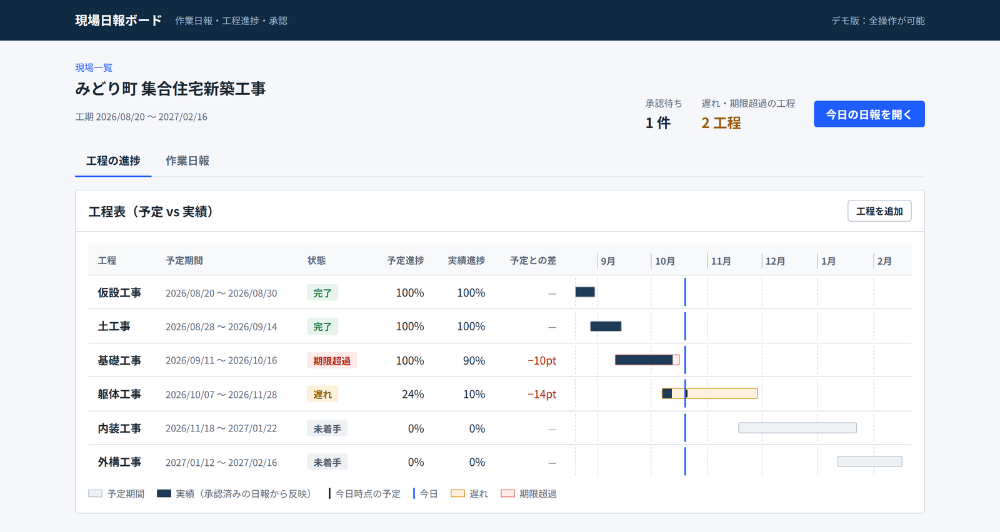
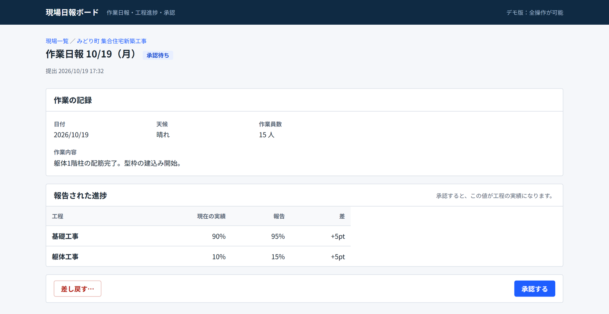
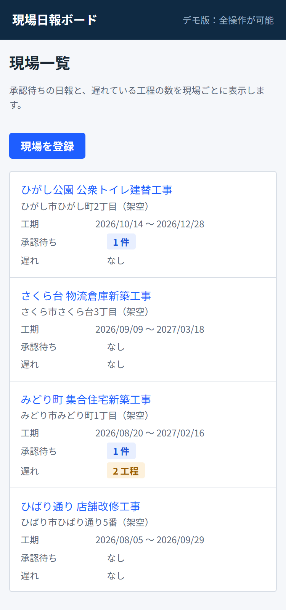
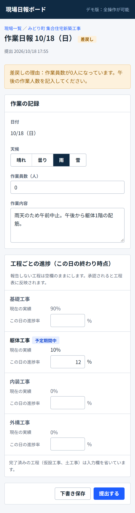
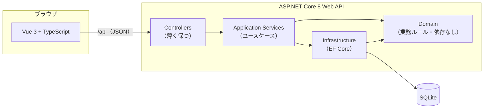
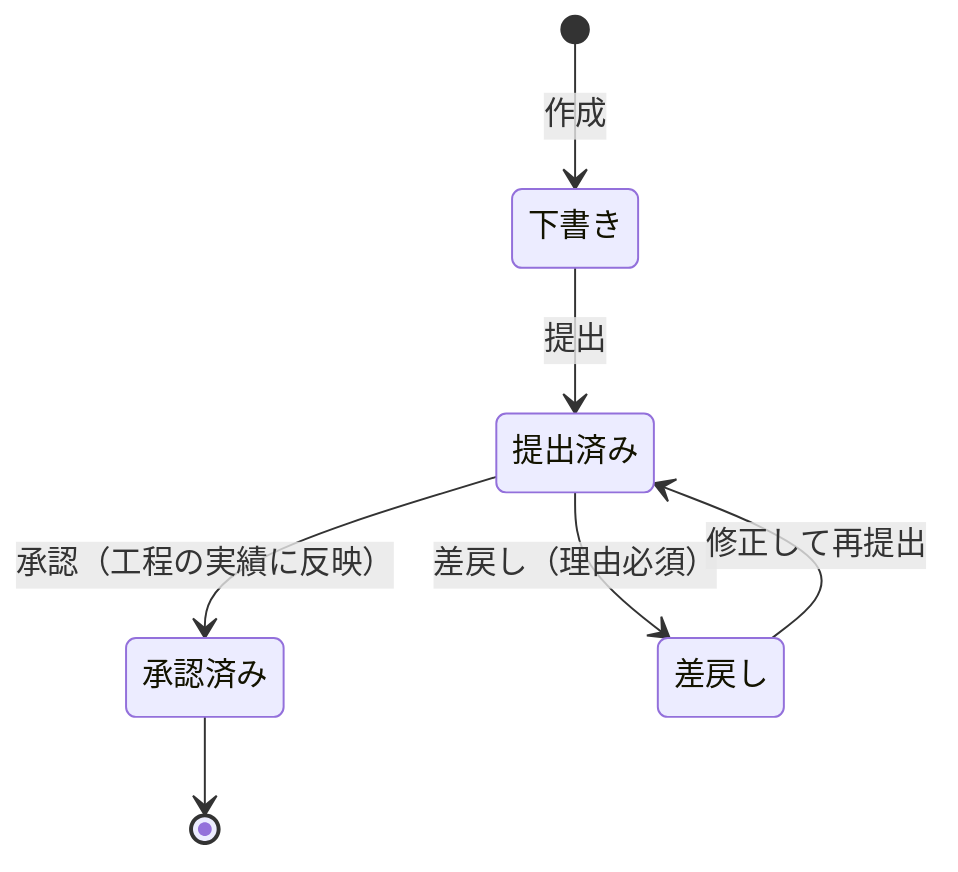

# 現場日報ボード（genba-nippo）

[](https://github.com/mukai-work/genba-nippo/actions/workflows/ci.yml)

建設現場の **作業日報・工程の進捗・承認フロー** を扱う小さな業務 Web アプリです。
**ASP.NET Core 8 Web API + EF Core** と **Vue 3 + TypeScript** で、設計からテストまで一人で作りました。



> 題材は一般的な建設業務（作業日報・工程管理）です。特定の企業・案件の情報や仕様は含みません。サンプルデータはすべて架空です。
> 認証・権限は対象外のデモ版です（日報の作成も承認も同じ画面で操作できます）。

## できること

| 機能 | 内容 |
|---|---|
| 現場 | 現場名・所在地・工期を登録。一覧で「承認待ちの日報」と「遅れている工程」の数がわかる |
| 工程表 | 工種ごとの予定期間と実績をガントチャート風に表示。**遅れ・期限超過を自動判定** |
| 作業日報 | 日付・天候・作業員数・作業内容・工程ごとの進捗率を記録 |
| 承認フロー | 下書き → 提出 → 承認 / 差戻し（理由必須）→ 修正して再提出。**承認された日報だけが工程の実績に反映** |
| 同時編集の検出 | 他の人が先に更新していたら 409 を返し、画面に「最新の内容を読み込む」ボタンを出す |
| CSV 出力 | 月ごとの日報を Excel でそのまま開ける CSV（UTF-8 BOM 付き）で出力 |

承認者が見る日報の画面（現在の実績からどう変わるかを確認して承認・差戻し）:



現場ではスマホで入力する前提で、狭い画面では表をカード状に縦積みにしています。

<p>
  
  
</p>

## 技術スタック

| 区分 | 使用技術 |
|---|---|
| バックエンド | C# 12 / .NET 8 / ASP.NET Core Web API（Controller ベース） |
| データアクセス | Entity Framework Core 8（Code First・マイグレーション）/ SQLite |
| API 仕様 | Swagger（OpenAPI）・エラーは RFC 9457 ProblemDetails で統一 |
| フロントエンド | Vue 3.5（Composition API・`<script setup>`）/ TypeScript 5.9 / Vue Router 4 / Vite 7 |
| テスト | xUnit（単体・`WebApplicationFactory` による結合）/ Vitest + Vue Test Utils |
| 品質 | ビルド警告をエラー扱い（`TreatWarningsAsErrors`）/ ESLint（typescript-eslint・eslint-plugin-vue）/ `vue-tsc` |
| CI | GitHub Actions（API と Web を並列でビルド・Lint・テスト） |

## 構成



| プロジェクト | 役割 |
|---|---|
| `src/GenbaNippo.Domain` | エンティティと業務ルール（状態遷移・遅れ判定・進捗反映）。外部ライブラリに依存しない |
| `src/GenbaNippo.Infrastructure` | EF Core の DbContext・テーブル定義・マイグレーション・サンプルデータ |
| `src/GenbaNippo.Api` | コントローラー・ユースケース・DTO・例外 → ProblemDetails 変換・SPA の配信 |
| `tests/GenbaNippo.Domain.Tests` | 業務ルールの単体テスト |
| `tests/GenbaNippo.Api.Tests` | API の結合テスト（インメモリ SQLite・日付固定） |
| `web/` | Vue 3 + TypeScript のフロントエンド |

### 日報の状態遷移



## 設計で工夫した点

詳しくは [docs/design.md](docs/design.md) にまとめています。

1. **業務ルールをドメインに閉じ込める** — 状態遷移は `DailyReport` クラスだけが持ち、許されない操作（承認済みの編集など）は例外にする。コントローラーに `if (status == ...)` を書かない。
2. **古い日報をあとから承認しても進捗が巻き戻らない** — 工程は「最後に反映した日報の日付」を持ち、それより古い日報では上書きしない。承認の順番は日付どおりとは限らないため。
3. **「今日」を注入してテストする** — .NET 8 の `TimeProvider` を DI し、テストでは `FakeTimeProvider` で日付を固定。サーバーが UTC で動いていても日本の日付で判定する（タイムゾーンは設定で変更可）。
4. **同時編集を 409 で返す** — 日報と工程の両方に版番号（`Version`）を持たせ、EF Core の同時実行トークンにしている。日報は画面が読み込んだ版と違えば 409。別々の日報が同時に承認されて同じ工程の進捗を取り合った場合も、後から保存した側を DB の UPDATE 時に検出する（どちらもテストで再現）。なお工程の版番号はこの承認時の競合に備えたもので、工程の名前・予定期間の変更（PUT）では版番号を比較していない。
5. **エラー応答を一元化** — .NET 8 の `IExceptionHandler` で業務例外を ProblemDetails に変換し、`type` で種類を区別する（同じ 409 でも「再読み込みで解消する衝突」と「状態が違う」を画面が見分ける）。入力の型変換エラーも日本語にそろえ、内部の型名は外に出さない。
6. **CSV は Excel 前提で作る** — BOM 付き UTF-8・CRLF・クォート処理に加え、`=` `+` `-` `@` で始まる自由入力の先頭に `'` を付けて無害化（CSV インジェクション対策）。代わりにその値は Excel 上で `'` 付きの文字として見える、というトレードオフを選んでいる。

## 起動手順

### 必要なもの

- [.NET 8 SDK](https://dotnet.microsoft.com/download)（8.0.400 以降）
- [Node.js](https://nodejs.org/) 20.19 以降

### 開発モード（API と画面を別々に起動）

```bash
# 1. API（http://localhost:5290、Swagger は /swagger）
dotnet run --project src/GenbaNippo.Api --launch-profile http

# 2. 画面（別のターミナルで。http://localhost:5192）
cd web
npm install
npm run dev
```

初回起動時に SQLite のデータベース（`src/GenbaNippo.Api/genba-nippo.db`）が作られ、架空のサンプル現場が4件入ります。
サンプルの日付は起動した日を基準にずらすので、いつ起動しても「遅れ」「期限超過」「未着手」「完了」の工程と、承認待ち・差戻しの日報が揃って見えます。
初期状態に戻したいときは `genba-nippo.db` を削除して API を起動し直してください。

開発中は Vite が `/api` を API に中継するため、CORS の設定は不要です。

### 1プロセスで動かす（本番に近い形）

```bash
cd web && npm install && npm run build   # src/GenbaNippo.Api/wwwroot に出力
cd .. && dotnet run --project src/GenbaNippo.Api --launch-profile http
# → http://localhost:5290 で画面と API の両方が動く
```

## テスト

```bash
dotnet test        # xUnit：Domain 54件・API 34件
cd web && npm test # Vitest：34件（npm run lint / npm run typecheck も CI で実行）
```

| テスト | 主な確認内容 |
|---|---|
| Domain（単体） | 予定進捗率の計算・遅れ判定の境界値・状態遷移の可否・進捗が巻き戻らないこと・入力チェック |
| API（結合） | 作成→提出→承認で工程の実績が更新される・古い版番号は 409・同時承認でも工程の進捗が古い値で上書きされない・同じ日の日報は 409・他現場の工程は 400・空の日付でも内部の型名を返さない・存在しない API は SPA ではなく 404・CSV の BOM と中身・サンプルデータの生成 |
| Web | API クライアントのエラー処理（`type` による 409 の区別・入力エラー・接続不可）・工程表の座標計算・状態ごとのボタン・日報画面（提出に失敗したあと再提出しても二重作成しない／空入力は送信前に止める／承認待ちは閲覧表示） |

## API

Swagger（`/swagger`）で試せます。主なエンドポイント:

| メソッド | パス | 内容 |
|---|---|---|
| GET / POST | `/api/sites` | 現場の一覧 / 登録 |
| GET | `/api/sites/{siteId}` | 現場の詳細 |
| GET / POST | `/api/sites/{siteId}/work-items` | 工程の一覧（遅れ判定つき）/ 登録 |
| PUT | `/api/work-items/{id}` | 工程の変更 |
| GET / POST | `/api/sites/{siteId}/reports?month=yyyy-MM` | 日報の一覧 / 作成 |
| GET / PUT | `/api/reports/{id}` | 日報の取得 / 編集（`version` 必須） |
| POST | `/api/reports/{id}/submit` `approve` `reject` | 提出 / 承認 / 差戻し（`version` 必須） |
| GET | `/api/sites/{siteId}/reports/export?month=yyyy-MM` | 月次 CSV |

## 設定

`src/GenbaNippo.Api/appsettings.json`

| キー | 既定値 | 内容 |
|---|---|---|
| `ConnectionStrings:Default` | `Data Source=genba-nippo.db` | SQLite の接続文字列 |
| `Database:ApplyMigrations` | `true` | 起動時にマイグレーションを当てる |
| `Database:SeedSampleData` | 開発時のみ `true` | 架空のサンプル現場を入れる |
| `Schedule:BehindTolerancePoints` | `10` | 予定より何ポイント遅れたら「遅れ」とするか |
| `Schedule:TimeZoneId` | `Asia/Tokyo` | 「今日」を決めるタイムゾーン（画面の提出・承認日時の表示は日本時間で固定） |

## 意図的に入れていないもの・今後

MVP として、次のものは意図的に外しています。

- 認証・権限（作成者と承認者の区別、「提出した本人は承認できない」ルール）— ASP.NET Core Identity または Microsoft Entra ID で追加予定
- HTTPS リダイレクト・ヘルスチェック・ログの集約など運用まわり（ローカルで動かすデモのため）
- 写真の添付（Azure Blob Storage を想定）
- SQL Server への切り替えと Azure App Service へのデプロイ
- .NET 10（LTS）への更新 — `TargetFramework` は `Directory.Build.props` の1か所で管理しているので、変更箇所はそこと NuGet パッケージの版だけで済む

## ライセンス

[MIT](LICENSE)
